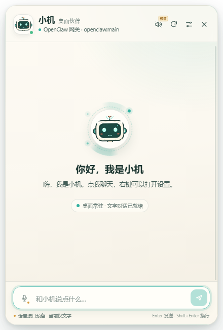
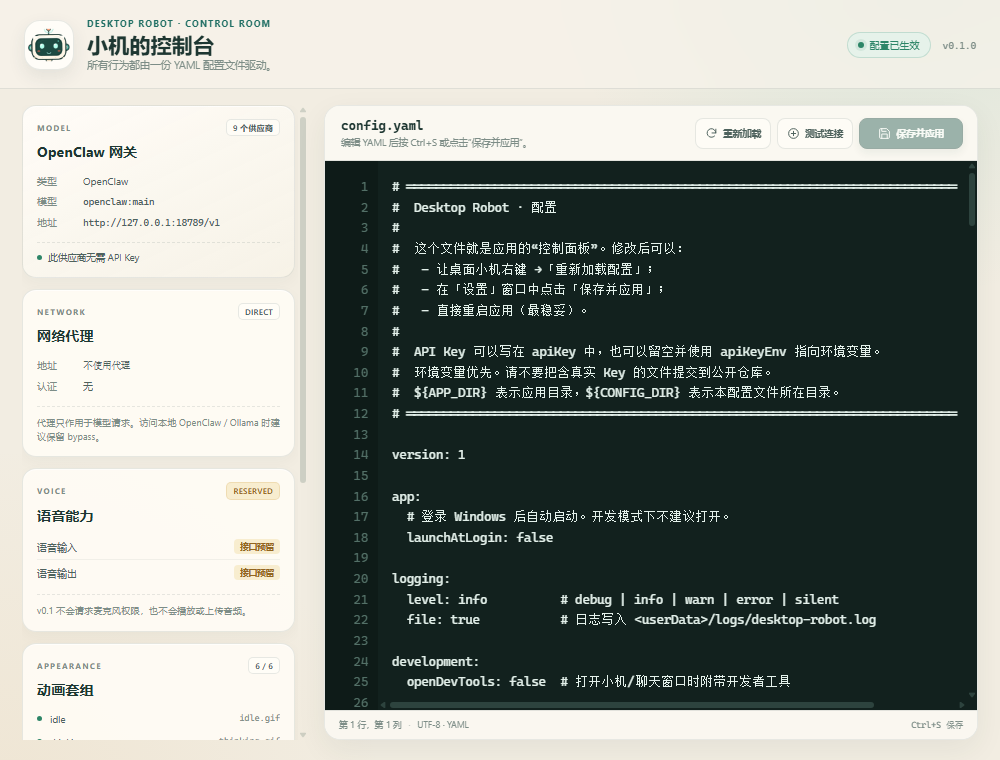

# Desktop Robot

一个常驻桌面的卡通机器人伙伴。它使用一整套可替换的 GIF 动画作为形象，支持文字对话，并通过 YAML 配置文件接入 OpenClaw、OpenAI、Anthropic Claude、Gemini、DeepSeek、OpenRouter、通义千问、Ollama 等模型服务。

**v0.1 定位**：先完成稳定可用的桌面形象、文字对话、模型配置、代理配置与语音扩展接口。语音输入/输出尚未接入实际模型，不会申请麦克风权限，也不会播放或上传音频。




[查看一段对话效果](docs/preview-chat-reply.png)



---

## 功能

- 透明、无边框、置顶的桌面机器人窗口，可拖动到任意位置。
- 一套 6 个状态的 GIF 动画：空闲、思考、说话、开心、错误、聆听（为语音预留）。
- 替换自己的 GIF 即可换形象；配置文件热更新，动画目录也支持自动热加载。
- 点击小机打开聊天；右键打开菜单；托盘常驻，可隐藏/显示/退出。
- 文字输入、文字输出、对话上下文、可选本地历史记录持久化。
- 任意 OpenAI 兼容服务、OpenClaw、Anthropic Messages API、Google Gemini API。
- 所有功能设置都在 `config/config.yaml` 中：模型、API Key、代理、人格、窗口、动画、快捷键、语音预留参数。
- 内置 YAML 配置编辑器与配置校验。
- 可配置直连、跟随系统代理或手动 HTTP/SOCKS 代理，适合访问 OpenAI / Claude 等服务。
- 语音输入/输出接口已预留（含 UI 占位与 `VoiceService` 边界），v0.1 不实际录音或播放。

---

## 启动（不需要命令）

这台机器已经创建好两个快捷入口：

- 桌面快捷方式：**「桌面小机」**
- 项目根目录：**`桌面小机.lnk`**

**双击「桌面小机」即可启动，不需要打开终端或输入任何命令。** 如果程序已经在运行，再次双击会唤醒桌面上的小机。

快捷方式指向项目里的 `launch.ps1`，它会隐藏启动窗口并启动 Electron。启动器会在项目内创建 `.runtime` 运行时目录。

如果以后移动了项目文件夹，重新生成快捷方式即可：

```powershell
cd desktop-robot
npm install        # 仅在依赖缺失时需要
npm run shortcut
```

首次启动会读取 `config/config.yaml`。该文件包含本地 API Key/Token，因此不进入版本库；如果缺失，应用会自动从 `config/config.example.yaml` 复制一份。

> 当前桌面快捷方式针对这台 Windows 机器的受限运行环境使用了 `--no-sandbox --disable-gpu`。应用只加载本地页面，并有 contextIsolation、CSP、导航拦截和权限拒绝；如果你在普通桌面环境中不需要这个兼容参数，可以编辑 `launch.ps1` 和 `scripts/start.js` 移除它。

### 调试用本地模型

没有 OpenClaw 或云端 API Key 时，可以使用内置的本地模拟网关先把 UI 跑起来：

```powershell
# 终端 1：启动一个只在本机监听的 OpenAI 兼容模拟服务
npm run mock

# 终端 2：启动桌面小机（默认 activeProvider 就是 openclaw）
npm start
```

模拟服务地址是 `http://127.0.0.1:18789/v1/chat/completions`，回复是预设文案，仅用于调试界面，不是大模型。

### 环境要求

- Windows 10/11（当前版本重点在 Windows 测试；Electron 代码本身跨平台）
- Node.js 20 或更高版本（当前依赖已安装，开发时使用 Node 24）
- npm（仅在重装依赖/开发时需要）

> 如果 `npm install` 后 Electron 可执行文件缺失（部分环境会跳过 postinstall），运行：
> `node node_modules/electron/install.js`

---

## 配置在哪里

当前配置路径：**`config/config.yaml`**

所有配置都可以直接编辑这个 YAML，然后：

- 在设置窗口中点击「保存并应用」；
- 右键小机 →「重新加载配置」；
- 外部编辑器保存后，应用会自动热加载；
- 或重启应用。

配置的完整注释示例见 [`config/config.example.yaml`](config/config.example.yaml)。这是唯一的配置源，没有隐藏的 GUI 设置。

安全提示：`config/config.yaml` 已被 `.gitignore` 忽略，因为里面可能含 API Key。建议优先使用 `apiKeyEnv` 从环境变量读取密钥。

---

## 连接 OpenClaw

OpenClaw 的 Gateway 提供一个可选的 OpenAI 兼容 HTTP 端点：

- `POST /v1/chat/completions`
- 默认端口通常为 `18789`
- 该 HTTP 端点默认关闭，需要在 OpenClaw 配置里启用

在 OpenClaw 中启用（详细说明见 [OpenClaw 文档](https://docs.openclaw.ai/gateway/openai-http-api)）：

```json5
{
  gateway: {
    http: {
      endpoints: {
        chatCompletions: { enabled: true },
      },
    },
  },
}
```

本项目的默认配置：

```yaml
llm:
  activeProvider: openclaw
  providers:
    openclaw:
      type: openclaw
      baseUrl: http://127.0.0.1:18789/v1
      model: openclaw/main
      agentId: ""
      apiKeyEnv: OPENCLAW_GATEWAY_TOKEN
      requiresApiKey: false
      timeoutMs: 120000
```

如果 Gateway 启用了 token 或 password 认证，设置环境变量后再启动应用：

```powershell
$env:OPENCLAW_GATEWAY_TOKEN = "你的 Gateway Token"
npm start
```

```bash
export OPENCLAW_GATEWAY_TOKEN="你的 Gateway Token"
npm start
```

也可以把 token 填到 `providers.openclaw.apiKey`，但更推荐环境变量。

**局域网连接**（例如 OpenClaw 运行在另一台电脑 `gateway.example.lan`）：

```yaml
openclaw:
  type: openclaw
  baseUrl: http://gateway.example.lan:18789/v1
  model: openclaw/main
  agentId: ""
  apiKey: "你的 Gateway Token"
  apiKeyEnv: ""
  requiresApiKey: true
```

务必保留 `baseUrl` 末尾的 `/v1`。在启用下面的 HTTP 端点之前，访问 `/v1/chat/completions` 会返回 **404 Not Found**；`/health` 正常只说明 Gateway 在线，不代表聊天端点已开启。

说明：

- `model` 使用 OpenClaw `/v1/models` 返回的模型 ID，例如 `openclaw/main`；部分版本也接受 `openclaw:<agentId>`。`agentId` 可选，设置后会以 `x-openclaw-agent-id` 请求头发送。
- 如果 `/v1/models` 有响应但 `/v1/chat/completions` 返回 404，说明 HTTP Chat Completions 端点未启用，而不是 Token 或 Agent 选择错误。
- 如果需要让 Gateway 复用同一个 Agent 会话，可以取消 `sessionUser` 注释；不设置时，每次请求都携带完整本地上下文。
- 使用 `npm run mock` 可测试没有 Gateway 时的界面。

---

## 配置主流模型提供商

在 `llm.providers` 中选一个供应商，然后把 `llm.activeProvider` 指向它。项目自带以下示例：

| Provider key | 类型 | 默认模型示例 | 必填环境变量 |
| --- | --- | --- | --- |
| `openclaw` | OpenClaw Gateway | `openclaw/main` | 可选 `OPENCLAW_GATEWAY_TOKEN` |
| `openai` | OpenAI 兼容 | `gpt-4.1-mini` | `OPENAI_API_KEY` |
| `anthropic` | Anthropic Messages | `claude-sonnet-4-5` | `ANTHROPIC_API_KEY` |
| `gemini` | Gemini generateContent | `gemini-2.5-flash` | `GEMINI_API_KEY` |
| `deepseek` | OpenAI 兼容 | `deepseek-chat` | `DEEPSEEK_API_KEY` |
| `openrouter` | OpenAI 兼容 | `openai/gpt-4.1-mini` | `OPENROUTER_API_KEY` |
| `qwen` | OpenAI 兼容 | `qwen-plus` | `DASHSCOPE_API_KEY` |
| `ollama` | OpenAI 兼容且本地 | `llama3.2` | 无 |
| `custom` | 任意 OpenAI 兼容服务 | `your-model-name` | `CUSTOM_API_KEY` |

模型名称请以你账户实际可用的模型为准；修改 `model` 即可。API Key 的解析顺序为：

1. `apiKeyEnv` 指定的环境变量（若有值）；
2. `apiKey` 内联值。

例如切到 Claude：

```yaml
llm:
  activeProvider: anthropic
```

```powershell
$env:ANTHROPIC_API_KEY = "sk-ant-..."
npm start
```

请求会按供应商类型自动使用正确协议：

- `openai-compatible`：`POST {baseUrl}/chat/completions`
- `openclaw`：同上，并附带 Agent Header
- `anthropic`：`POST {baseUrl}/messages`
- `gemini`：`POST {baseUrl}/models/{model}:generateContent`

每个 provider 还支持：

```yaml
headers:
  X-Custom-Header: value
extraBody:
  reasoning_effort: low
temperature: 0.7
maxOutputTokens: 1000
timeoutMs: 60000
maxTokensParam: max_tokens   # 某些模型需要 max_completion_tokens
requiresApiKey: true
```

---

## 网络代理

代理设置位于 `config/config.yaml`：

```yaml
network:
  proxy:
    mode: manual
    url: "http://127.0.0.1:7890"
    bypass: "localhost,127.0.0.1,::1,<local>"
    username: ""
    password: ""
    usernameEnv: ""
    passwordEnv: ""
```

`mode` 可选：

- `direct`：不使用代理。
- `system`：跟随操作系统代理设置。
- `manual`：使用 `url` 指定的 HTTP / HTTPS / SOCKS4 / SOCKS5 代理。

OpenAI、Claude、Gemini 等海外服务通常需要 `manual` 代理。代理只作用于应用的模型请求网络栈（Electron `net.fetch`）；页面本身没有外部网络访问。`bypass` 中保留 `localhost,127.0.0.1` 可以让 OpenClaw / Ollama 本地服务绕过代理。

代理认证支持直接填写账号密码，也支持从环境变量读取（推荐）：

```yaml
usernameEnv: PROXY_USERNAME
passwordEnv: PROXY_PASSWORD
```

保存配置后会立即应用代理并关闭旧的网络连接。设置窗口中可以点击「测试连接」验证当前模型链路。

---

## 更换 GIF 形象

默认动画目录：

```yaml
appearance:
  animationsDir: "${APP_DIR}/assets/animations"
  animations:
    idle: idle.gif
    thinking: thinking.gif
    talking: talking.gif
    happy: happy.gif
    error: error.gif
    listening: listening.gif
  fallbackImage: "${APP_DIR}/assets/icons/robot.png"
  watchAnimations: true
```

- 可以直接替换 `assets/animations/` 下的六个 GIF。
- 也可以把 `animationsDir` 指向自己的文件夹，或在 `animations` 中把某个状态改为绝对路径 / 相对 `animationsDir` 的文件名。
- 状态说明：`idle` 空闲，`thinking` 等待模型，`talking` 正在显示回复，`happy` 打开对话/新会话，`error` 请求失败，`listening` 为未来语音输入预留。
- 建议 GIF 为透明背景、约 360×360、循环动画。缺失某个 GIF 时会回退到 `fallbackImage`；配置校验会给出提醒。
- `${APP_DIR}` 是应用目录，`${CONFIG_DIR}` 是配置文件所在目录。相对路径以配置文件目录为基准。
- `watchAnimations: true` 时，替换 GIF 会自动热加载。也可以在设置窗口中点击「重新加载」。

默认动画由 [`scripts/generate_animations.py`](scripts/generate_animations.py) 用 Pillow 代码生成，不依赖外部素材。重新生成：

```powershell
pip install pillow numpy
python scripts/generate_animations.py
```

[查看六种动画状态的预览](docs/animation-preview.png)

---

## 语音接口（预留，v0.1 不启用）

v0.1 明确不实现语音：

- 不会申请麦克风权限；
- 不会录音、转写、上传音频；
- 不会播放 TTS 音频；
- UI 中的麦克风和扬声器按钮点击后只会提示「接口预留」；
- `voice` 配置会被校验，但 `available` 始终为 `false`。

后端已经留好 `VoiceService`：

```js
// src/main/voice.js
async transcribe(audio, options) { ... } // 未来 ASR
async synthesize(text, options) { ... }  // 未来 TTS
```

接入方式、建议的接口边界和需要修改的位置见 [`docs/voice.md`](docs/voice.md)。

---

## 使用方式

- **左键点击小机**：打开/关闭聊天窗口。
- **按住拖动**：移动桌面位置；位置默认记忆在 `userData/window-state.json`。
- **右键点击小机**：打开菜单（设置、重载配置、隐藏、退出）。
- **托盘图标**：双击打开聊天，右键打开菜单。
- **Enter**：发送；**Shift+Enter**：换行；**Esc**：关闭聊天（可在配置中关闭）。
- **设置窗口**：编辑 YAML，`Ctrl+S` 或「保存并应用」；支持「测试连接」和从磁盘重新加载。

常用配置：

```yaml
window:
  alwaysOnTop: true
  openChatOnStart: false
  rememberPosition: true
appearance:
  accentColor: "#2FAF9F"
  bubbleDurationMs: 6500
chat:
  maxHistoryMessages: 24
  maxInputChars: 4000
  persistHistory: false
persona:
  name: 小机
  systemPrompt: |
    你是...
```

---

## 项目结构

```text
desktop-robot/
├─ config/
│  ├─ config.example.yaml   # 带完整注释的模板
│  └─ config.yaml           # 当前生效配置（gitignored）
├─ src/
│  ├─ main/                 # Electron 主进程
│  │  ├─ index.js           # 生命周期、配置热加载、代理、托盘、IPC 装配
│  │  ├─ config.js          # YAML 校验、路径解析、公开配置脱敏
│  │  ├─ windows.js         # 小机/聊天/设置窗口、拖动、窗口状态
│  │  ├─ chat-service.js    # 会话、错误处理、宠物状态联动
│  │  ├─ conversation.js    # 上下文裁剪与可选持久化
│  │  ├─ voice.js           # 预留的 VoiceService 边界
│  │  ├─ proxy.js           # 代理解析与 Electron session 应用
│  │  └─ llm/               # OpenAI 兼容 / OpenClaw / Anthropic / Gemini 适配器
│  ├─ preload/              # contextBridge 白名单 API
│  └─ renderer/
│     ├─ pet/               # 透明桌面形象
│     ├─ chat/              # 聊天界面
│     └─ settings/          # 配置编辑器
├─ assets/
│  ├─ animations/           # 6 个默认 GIF
│  └─ icons/                # 静态形象、托盘、应用图标
├─ scripts/
│  ├─ generate_animations.py
│  ├─ mock-openclaw.js      # 本地调试用模拟网关
│  ├─ start.js              # npm start 的开发启动器
│  ├─ create-shortcut.ps1   # 重新生成桌面/项目快捷方式
│  └─ check-project.js
├─ launch.ps1               # 桌面快捷方式调用的隐藏启动器
├─ 桌面小机.lnk              # 项目内快捷入口（本地生成，不提交 git）
├─ tests/                   # 配置、代理、会话、各模型适配器测试
└─ docs/
```

项目没有提交桌面快捷方式本身（它含本机绝对路径，已加入 `.gitignore`）；`npm run shortcut` 可以随时重建。

架构说明见 [`docs/architecture.md`](docs/architecture.md)，完整配置字段见 [`docs/configuration.md`](docs/configuration.md)。

---

## 开发与测试

```powershell
npm test          # Node 内置测试：配置/会话/代理/LLM 适配器
npm run check     # 检查文件、GIF 和当前配置
npm run mock      # 本地模拟 OpenClaw Gateway
npm start         # 启动桌面应用
```

是否打开开发者工具由配置中的 `development.openDevTools` 决定。

可在配置中打开主进程渲染窗口的开发者工具：

```yaml
development:
  openDevTools: true
```

快捷方式和 `npm start` 使用项目内的运行时目录 `.runtime/`（已 gitignore）：

- `.runtime/logs/desktop-robot.log`
- `.runtime/window-state.json`
- `.runtime/conversation.json`（仅 `chat.persistHistory: true`）

可以用 `DESKTOP_ROBOT_USER_DATA` 环境变量指定独立的运行时目录，用 `DESKTOP_ROBOT_CONFIG` 指定另一个配置文件，方便便携运行或测试。直接执行 Electron 时，默认用户数据目录是 Windows 的 `%APPDATA%\Desktop Robot`。

---

## 安全与隐私

- API Key 只保存在本地配置或环境变量中；不会发送给渲染进程的公共配置快照，也不会写入日志。
- 配置编辑器加载的是本地 YAML，因此里面会显示你填写的 Key；请勿把 `config.yaml` 提交到公开仓库。
- 模型请求从 Electron 主进程发出，渲染进程被 CSP 限制为不能直接联网。
- 渲染窗口启用 `contextIsolation`、`sandbox` 与白名单 preload；麦克风/摄像头等权限请求默认拒绝。
- 当前桌面快捷方式/开发启动器为兼容本机受限桌面环境使用了 `--no-sandbox --disable-gpu`，会关闭 Chromium 的进程沙箱。本项目只加载仓库内的本地页面，不导航外部页面，并保留 contextIsolation、CSP 与权限拒绝；在普通环境中建议移除这两个参数。
- v0.1 不录音、不采集语音、不集成遥测。
- 默认不持久化聊天；启用 `chat.persistHistory` 后历史只写入本机 `userData/conversation.json`。

---

## 已知限制

- v0.1 只做文字对话，语音输入/输出仅预留。
- 不做流式输出；回复一次性从模型返回，再由界面逐字显示。
- 未提供安装包/签名；当前通过 `npm start` 运行源码。后续可用 electron-builder 打包。
- 图片是 GIF，边缘为二值透明；如需更细腻的半透明边缘，可在未来版本支持 WebP/APNG。
- 主要按 Windows 桌面交互测试。

## License

MIT，见 [LICENSE](LICENSE)。
